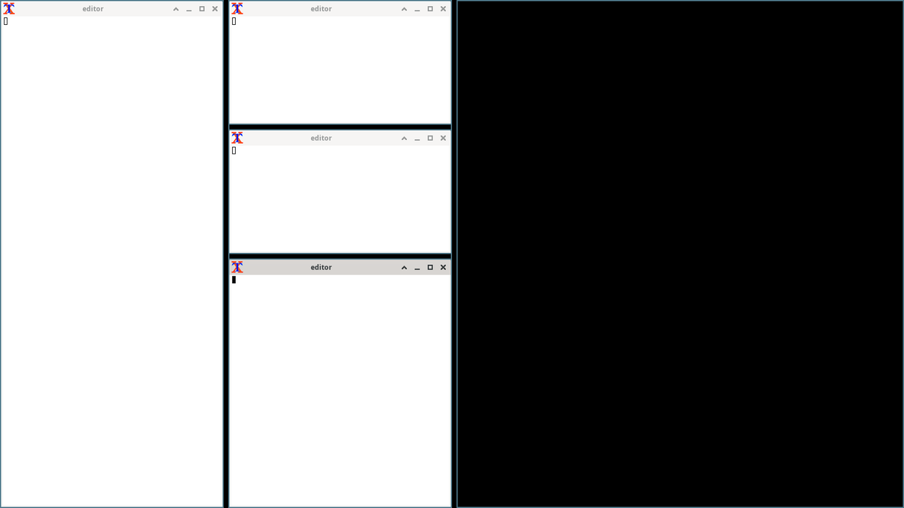

# Pergola

A **fractal window manager layer for X11 desktops** — windows nest inside windows
as deep as you like, and a camera lets you zoom into the part you need.

Pergola is a Rust reimplementation of the model popularised by
[TrellisWM](https://trelliswm.app) for macOS, rebuilt as a Linux window-manager
*layer* rather than a replacement: it never takes over the display, so it runs
inside xfwm4, mutter (X11), kwin_x11, i3, openbox, awesome, or any other
EWMH-compliant window manager.



```text
 root ── split(x) ─┬─ p-editor ────────────────────────┐
                   ├─ split(y) ─┬─ p-browser ──────────┤
                   │            └─ p-terminal ─────────┤
                   └─ desktop (floating windows) ──────┘
```

## What this is (and is not)

* **Is**: a real, installed, tested window manager *layer*. It docks, nests,
  resizes, zooms, saves views and restores layouts on a running X11 desktop.
* **Is not**: a fork, port or derivative of TrellisWM's code. TrellisWM is
  closed-source; Pergola is a clean-room implementation of the *observable
  model* (recursive split tree + camera), derived from public documentation and
  a public clean-room study. See [docs/RESEARCH.md](docs/RESEARCH.md) and
  [NOTICE](NOTICE) for provenance.
* **Is not**: a Wayland compositor. Wayland clients cannot be moved by an
  external process; Pergola needs X11 (or XWayland, where it can manage X11
  clients only).

## Install

```bash
git clone https://github.com/SyntheticPrometheus/pergola
cd pergola
./install.sh            # build, install to ~/.local/bin, autostart, start now
```

Requirements: Rust (1.75+), an X11 session, `rofi` (or `zenity`/`yad`/`dmenu`) only
for the action palette, `xdotool`/`wmctrl` only for the optional test script. No root, no daemon privileges, no Accessibility-style
permission prompt. `install.sh` installs `pergola` and `pergola-health` into
`~/.local/bin`, writes `~/.config/pergola/config.json` (only if absent), and
adds a systemd user unit plus an XDG autostart entry so the daemon starts with
your session. `./install.sh --no-start` skips the start.

```bash
pergola doctor          # display, EWMH client list, running WM
pergola status          # the daemon's view: screen, panels, depth, gap, overlay
pergola keys --check    # which chords are free on this desktop
pergola-health          # soak check; exits non-zero on any failure
```

New here? **[docs/FIRST-RUN.md](docs/FIRST-RUN.md)** is the five-minute
walkthrough — two terminals, two docks, and a glossary for every term the
`status` line prints. Full install, upgrade, uninstall and troubleshooting
reference: **[docs/SETUP.md](docs/SETUP.md)**.

## Quick start

```bash
pergola dock left        # dock the focused window to the left of its space
pergola dock right       # dock the next window beside it
pergola dock down        # nesting: a split inside a split
pergola frame-window     # frame the focused window (again to go back)
pergola zoom-out         # step one level out
pergola arrange          # tile every window into a balanced fractal tree
pergola float-all        # give every window back to the desktop layer
pergola tree             # the layout document, as JSON
pergola rects            # every panel's current frame rectangle
```

## Commands

| Command | Meaning |
|---|---|
| `everything` | show the whole tree (zoom all the way out) |
| `zoom-in` / `zoom-out` | step one level in / out |
| `back` / `forward` | browser-style camera history |
| `frame-window` / `frame-desktop` | frame the focused window / the desktop layer |
| `toggle-desktop` | hide or show floating windows |
| `neighbour <left\|right\|up\|down>` | move to the neighbouring space |
| `view <1-9>` / `save-view <1-9>` | saved views |
| `dock <edge> [--window ID] [--target ID]` | dock a window against another space |
| `float [--window ID]` | return a window to the desktop layer |
| `arrange` / `float-all` | tile everything / float everything |
| `split-terminal` | split the focused window with a new terminal |
| `gap <px>` | gap between tiles |
| `palette` | a menu of the tile actions, for the mouse (rofi/zenity/dmenu) |
| `overlay [on\|off\|toggle]` | draw split lines in the gaps (off by default) |
| `bind <command> [chord…]` / `unbind <command>` | change a chord without editing JSON |
| `status` `tree` `list` `rects` `keys` `doctor` `sim` | inspection |
| `reload` `save` `stop` | daemon control |

Every command also has a URL form: `pergola://zoom-in`,
`pergola://neighbour?dir=left`, `pergola://view?n=3`.

## Hotkeys

Primary bindings mirror TrellisWM's `⌃⌥` shortcuts; when the desktop already
owns a chord (xfwm4 owns `Ctrl+Alt+arrows` and `Ctrl+Alt+D`), Pergola falls back
to `Super` for that command and reports it at startup.

| Keys | Command |
|---|---|
| `Ctrl+Alt+Space` | everything |
| `Ctrl+Alt+↑` / `↓` | zoom-out / zoom-in |
| `Ctrl+Alt+←` / `→` | neighbour left / right |
| `Ctrl+Alt+[` / `]` | back / forward |
| `Ctrl+Alt+Return` | frame-window |
| `Ctrl+Alt+Shift+←` / `→` | **dock the focused window left / right** |
| `Ctrl+Alt+Shift+↑` / `↓` | **dock it above / below** |
| `Ctrl+Alt+Shift+W` | **float the focused window** |
| `Ctrl+Alt+M` | **action palette** (mouse-friendly menu) |
| `Ctrl+Alt+D` | toggle-desktop |
| `Ctrl+Alt+N` | split-terminal |
| `Ctrl+Alt+A` | arrange |
| `Ctrl+Alt+F` | float-all |
| `Ctrl+Alt+O` | overlay |

**You can tile with three keys and no terminal:** focus a window, `Ctrl+Alt+Shift+←`,
focus the next one, `Ctrl+Alt+Shift+→`. That is two tiles side by side.

`Super+…` is the automatic fallback for any chord the desktop already uses (xfwm4
owns `Ctrl+Alt+arrows`, so the camera keys fall back to `Super+arrows` there; the
daemon says so at startup). `pergola keys --check` prints the chord actually bound
for each command, so it never shows a chord the desktop intercepts; the palette
(`Ctrl+Alt+M`) lists the same actions by name.

## Mouse

The drag actions need no command line:

* **Drag a split boundary** — the gap between two tiles is a 6 px grab strip with
  a resize cursor. Drag it to change the split's weights (both neighbours move,
  never below `minimum_share`). It works while zoomed, and the pointer keeps the
  grab even though the boundary moves under it.
* **Drag a window to a screen edge** — let go within 14 px of the left, right, top
  or bottom of the work area and it docks to that edge. Drop a second window on
  the opposite edge and you have two tiles.
* **Drag a tile away from the edge** — it floats again where you dropped it, so
  the mouse can undo a tile without a command.
* **`Ctrl+Alt+M` or `pergola palette`** — a menu of the actions with human names
  ("Tile this window right", "Arrange all windows"); it needs `rofi` (recommended)
  or `zenity`/`yad`/`dmenu`, and is mouse-clickable as well as type-to-filter.
  Without a menu program the hotkey fails into the daemon log; run
  `pergola palette` in a terminal to see the error, or set `PERGOLA_MENU`.

Docking is resolved against the last focused space, so in a nested layout a drop
joins the tile you were last working in. `edge_dock: false` in the config turns
the edge behaviour off if a drag should never tile.

## Configuration

`~/.config/pergola/config.json` (all keys optional):

| Key | Default | Effect |
|---|---|---|
| `gap` | `6.0` | pixels between tiles and width of the overlay divider |
| `minimum_share` | `0.05` | smallest fraction a tile can be squeezed to |
| `auto_dock` | `false` | dock new windows automatically instead of floating them |
| `overlay` | `false` | draw the split lines and viewport frame |
| `desktop_share` | `0.0` | desktop strip `arrange` keeps; `0` gives it none |
| `terminal` | `$TERMINAL`, else `xfce4-terminal` | program used by `split-terminal` |
| `hotkeys` | `true` | grab the default chords on the root window |
| `edge_dock` | `true` | dock a window dropped on a screen edge (mouse tiling) |
| `bindings` | `{}` | per-command chord overrides, `command → [chord, …]` |

`pergola reload` re-reads the file and re-grabs the hotkeys, so a `bindings`
edit takes effect without a restart. `overlay` still applies on daemon restart.
The `gap` and `overlay` commands change the running session only. See
[docs/SETUP.md](docs/SETUP.md#configuration) for the details.

### Remap a key

One command, no JSON editing:

```sh
pergola bind "gap 12" Super+9   # bind a command to a chord and reload
pergola bind "gap 12"           # show what it is bound to and where it comes from
pergola bind "gap 12" --default # drop the override, back to the default chord
pergola unbind "gap 12"         # remove the chord entirely
```

These write `config.json` for you (preserving every other setting), reload the
daemon, and print any conflict the daemon reported — a chord the desktop owns,
for example — so you see it where you ran the command. A daemon that is not
running is not an error: the change is saved and applies at the next start.

For several changes at once, edit the `bindings` map directly. It maps a command
to the chords to try, in order. Naming a command
replaces its default chords entirely; an empty list unbinds it; commands you do
not mention keep their defaults. Any command the daemon understands can be
bound, not only the ones in the default plan:

```json
{
  "bindings": {
    "zoom-out": ["Super+Page_Up"],
    "back": ["Super+b", "Alt+b"],
    "view 3": ["Super+3"],
    "overlay": []
  }
}
```

After saving, run `pergola reload` and check the result with
`pergola keys --check`: it prints the chord the daemon actually grabbed, or
`off` for a command you unbound deliberately. `pergola bind <command>` with no
chord shows the same answer for one command.

## How it works

The window tree is the whole model (every term in this section is defined in
the [first-run glossary](docs/FIRST-RUN.md#glossary)):

```text
Node    := Desktop | Panel | Split
Desktop := { kind:"desktop", id:"desktop" }            # the floating layer
Panel   := { kind:"panel", id, views:[SeatID], selected, tabbed? }
Split   := { kind:"split", id, axis:"x"|"y", children:[Node], weights:[f64] }
```

* A `Split` may contain `Split`s. That recursion is the fractal part.
* Exactly one `Desktop` leaf exists; it is a *space*, not the screen, and
  floating windows live inside whatever rectangle it currently occupies.
* The camera is just a framed node id plus back/forward stacks and nine saved
  views. Framing a node maps it onto the screen and everything else moves with
  it — a real, continuous zoom, not a workspace switch.
* Geometry is applied through `_NET_MOVERESIZE_WINDOW`, the same EWMH request
  `wmctrl` uses, so the running WM keeps its decorations, gravity and
  constraints intact.
* The tree, camera and window fingerprints persist to
  `${XDG_STATE_HOME:-~/.local/state}/pergola/layout.json` (document `version: 2`,
  shape-compatible with the layout files described in the research note).

Architecture: `pergola-core` (pure engine, no X11 — tree, geometry, camera,
commands, document), `pergola-x11` (EWMH enumeration, moves, hotkey grabs,
overlay), `pergola` (daemon + CLI + Unix-socket IPC). See
[docs/DESIGN.md](docs/DESIGN.md).

Why each edge case is handled the way it is: [docs/HISTORY-LESSONS.md](docs/HISTORY-LESSONS.md)
classifies 700 issues filed against the seven tiling window managers that came
before Pergola and maps every failure class to the fix that answers it.

## Known limitations

* **X11 only.** No Wayland-native support; XWayland clients only.
* Verified inside **xfwm4** (XFCE) and **Openbox**, live and in isolation; any
  EWMH window manager should work, but only those two have been measured.
* Windows outside the framed view are moved off-screen. Some WMs (xfwm4) clamp
  them to keep a sliver reachable, so a docked tile can peek at the screen edge.
* Windows that set size hints (terminals with a character grid) are fitted to
  their own resize increment before the frame is placed, so the tile covers its
  slot without the WM clamping it short. A tile is therefore at most one
  character cell narrower than the slot, and `pergola rects` reports the slot.
* Dialogs and transient windows (`WM_TRANSIENT_FOR`) are not tiled: they keep the
  geometry their toolkit gave them, and a dock request for one fails with
  "not managed by pergola" rather than placing a dialog in a tile.
* Tab groups are modelled (`views.len() > 1`) but there is no drag-to-tab UI yet.
* A split's ratio can be changed by dragging its gap, not by a command; there is
  no `pergola ratio`. With `gap: 0` there is no strip to grab at all.
* The palette is a fixed list of actions, not a context-aware one (it offers
  "Float this window" even for a window that is already floating).
* Edge docking targets the last focused space; in a deep tree the landing spot may
  be nested rather than at the root, which reads as "it went where I was working".
  Aim at the edge you want, not at an empty region of the screen.
* The overlay is drawn with 2–3 px override-redirect rectangles inside the gaps
  and around the viewport; there is no dimming without a compositor.
* Only one instance per display (one Unix socket).

## Development

```bash
cargo test               # 66 unit tests: geometry, tree, camera, commands, document
scripts/e2e.sh           # 43 assertions against Xvfb + xfwm4 + real xterms
scripts/health.sh        # soak check of a running daemon (cpu, layout, drift, orphans)
scripts/health.sh --e2e  # the above plus the regression suite
cargo build --release
```

`install.sh` also installs `pergola-health`, the same soak check under a stable name, so a
scheduler or a timer can run it unattended and act on the exit code. `BACKLOG.md` is the
development queue: every item names what is done when. Human-interface pain points — with a
severity and a proposed fix each — are recorded in [docs/UX-NOTES.md](docs/UX-NOTES.md).

The end-to-end script starts its own X server, window manager and windows, so it
does not touch your session. It asserts geometry as the X server reports it, not
just the daemon's own bookkeeping.

Versioning: [docs/VERSIONING.md](docs/VERSIONING.md). Current version is
`0.4.0-dev` — pre-stable, no compatibility promises.

## License

MIT © SyntheticPrometheus. "TrellisWM" is a trademark of its owner and is used
here only to describe the model Pergola reimplements. No code from TrellisWM or
from the clean-room study is included. See [NOTICE](NOTICE).
